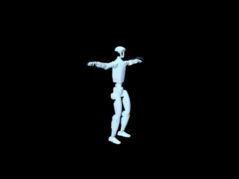
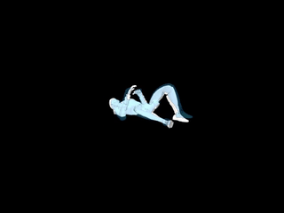
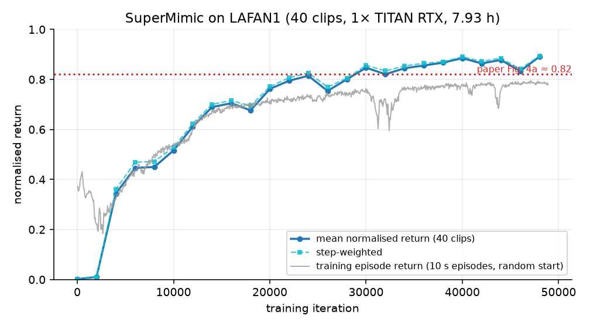
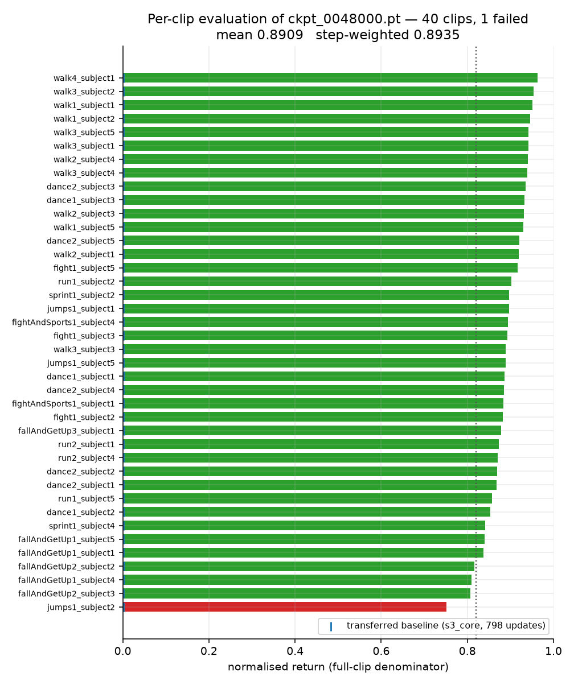
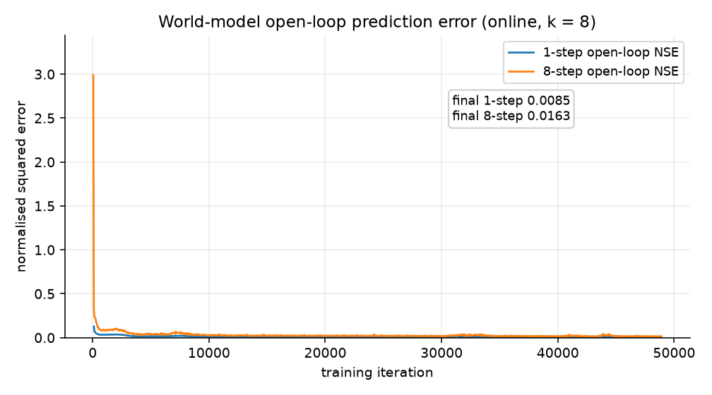
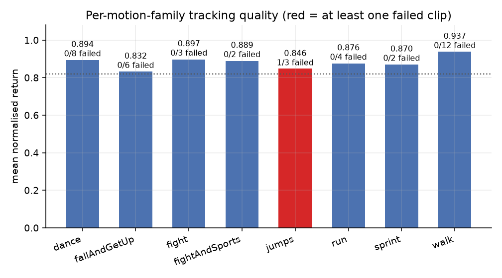

# SuperMimic on LAFAN1 — full-scale reproduction on a single TITAN RTX

An independent, from-scratch reproduction of **SuperMimic: Scaling Humanoid Whole-Body Control with
One Differentiable World Model** (arXiv:2610.28480, CoRL 2026) on the controlled LAFAN1 comparison of
Fig. 4a: **one policy tracking all 40 G1-retargeted LAFAN1 clips (2.451 h of motion)**, trained on a
single consumer/workstation GPU.

| | |
|---|---|
| **Result (main)** | **0.8849 mean normalised return**, **1/40 failed clips** — independent re-evaluation |
| Paper Fig. 4a reference | ≈ 0.82 |
| Hardware | 1 × NVIDIA TITAN RTX 24 GB (Turing, sm_75), Windows 10 x64 |
| Data | 40 clips, 441,140 frames @ 50 Hz, **2.451 h** |
| Training | **7.93 h**, 48,900 iterations, 19,534 policy updates, 4096 envs (2.0 × 10⁸ env steps) |
| World model | final open-loop NSE **0.0085** (1 step) / **0.0163** (8 steps) |
| Best checkpoint | `ckpt_0048000.pt` (iteration 48,000 / 19,174 updates) |

**Read the result honestly:** this reproduction uses an observation set that is *wider* than the
paper's Table A.1 (it adds a reference-anchor-relative pose; see
[docs/PAPER_DIFFERENCES.md](docs/PAPER_DIFFERENCES.md)). It therefore **does not** claim to beat the
paper under identical conditions. What it does claim is that the paper's Alg. A.1 core method, run at
the paper's own budget on this hardware, reaches the reported LAFAN1 score. The evaluation also has a
small residual run-to-run spread (≈ ±0.006, not a confidence interval) — see
[docs/EVALUATION.md](docs/EVALUATION.md).

---

## Result visualisations

### Reference motion (blue ghost) vs. the trained policy

`walk1_subject1` — a representative success. Solid robot = policy, blue ghost = reference pose:



`fallAndGetUp2_subject3` — a genuine terminating rollout, shown up to the termination at step 4,922
(the same weights also complete this clip in other runs):



Both hard clips are shipped as MP4s, and neither is reproducibly a failure: `fallAndGetUp2_subject3`
terminated in 4 of 6 recorded runs of this checkpoint and `jumps1_subject2` in 2 of 5. That is the
±0.006 reproducibility caveat made visible, and it is why this repository reports a failure *count*
(1/40) rather than a settled list of failing clips. Every video's clip, checkpoint, length, termination
step and camera settings are recorded in [docs/MEDIA.md](docs/MEDIA.md) and `results/rollout_*.json`.

### Training curve



### Per-clip result (all 40)



### World-model prediction error



### Per-motion-family summary



---

## What this repository contains

* the **core method** — real MuJoCo-Warp data collection (4096 envs, domain randomisation, action
  noise), an **8-step autoregressive world model**, **H = 32 imagined rollouts**, **BPTT through the
  frozen world model**, and a **critic trained on GAE(λ = 0.95)**;
* the **data pipeline** — LAFAN1 G1 download, 30 → 50 Hz resampling with finite-difference
  velocities, and MuJoCo forward kinematics of the 14 tracked bodies;
* **training and evaluation harnesses** with the exact command lines used for the reported numbers;
* **curated results** (evaluation tables, figures, rollout metadata) and the **media** generated from
  the real evaluation environment.

It does **not** contain motion data, checkpoints, caches or full training logs — see
[What is not included](#what-is-not-included).

## Quick start

All commands below are the ones actually used; each was verified against the scripts in `scripts/`.
`python` is Python 3.12 with the environment of [docs/ENVIRONMENT.md](docs/ENVIRONMENT.md).

```bash
# 0) environment sanity + forward/backward check (~1 min, compiles the Warp kernels on first run)
python scripts/check_env.py

# 1) data: download the 40 G1 CSVs, then convert them to the 50 Hz npz library
python scripts/data/download_lafan1_g1.py --out-dir data/raw/lafan1/g1
python scripts/data/csv_to_npz_batch.py \
    --input-dir data/raw/lafan1/g1 --output-dir data/npz/lafan1 --input-fps 30.0 --workers 12

# 2) train (this is the exact command of the reported run)
python scripts/full_train.py \
    --run-name lafan1_full --log-root logs --npz-dir data/npz/lafan1 \
    --num-envs 4096 --replay-capacity 1000 --episode-length-s 10.0 --anchor-obs \
    --amp --compile default \
    --wm-hidden 2048 2048 2048 --wm-window 8 --wm-batch 2048 --wm-batches 10 \
    --pi-batch 4096 --horizon 32 --critic-epochs 5 --critic-minibatches 4 \
    --term-head analytic --term-temp 0.05 \
    --lr 2e-4 --lr-decay-fraction 0.78125 \
    --total-iterations 320000 --updates-per-env-step 0.4 \
    --warmup 64 --policy-warmup-updates 0 \
    --log-interval 50 --checkpoint-interval 2000 --max-hours 9

# 3) evaluate every checkpoint on all 40 clips, in a second process
python scripts/eval_watch.py --log-dir logs/lafan1_full --npz-dir data/npz/lafan1 \
    --num-envs 40 --poll-seconds 90 --target-return 0.82

# 4) rebuild the tables / figures from the run
python scripts/make_figures.py --run-log logs/lafan1_full_stdout.log \
    --run-dir logs/lafan1_full --results-dir results --figures-dir results/figures

# 5) render a rollout video with the reference ghost
python scripts/render_rollout.py --ckpt logs/lafan1_full/ckpt_0048000.pt --clip walk1_subject1 \
    --out media/walk1_subject1.mp4 --gif media/preview_success.gif \
    --seconds 8 --width 640 --height 480 --fps 50
```

Time and memory expectations, plus the throughput benchmark used to pick the budget, are in
[docs/TRAINING.md](docs/TRAINING.md). The heading of each section above links to the detailed page.

## Results

| policy | policy updates | mean normalised return | step-weighted | failed clips |
|---|---|---|---|---|
| transferred `s3_core/ckpt_init` (baseline) | 56 | 0.0018 | 0.0018 | 40/40 |
| transferred `s3_core/ckpt_final` (baseline) | 798 | 0.0019 | 0.0018 | 40/40 |
| this run, `ckpt_init` (before training) | 0 | 0.0018 | — | 40/40 |
| **this run, `ckpt_0048000` — independent re-evaluation** | **19,174** | **0.8849** | **0.8899** | **1/40** |
| this run, `ckpt_0048000` — watcher run | 19,174 | 0.8909 | 0.8935 | 1/40 |

The evaluation protocol (Appendix F.1) starts each clip at its **first frame** with no observation or
action noise, no reset noise, no domain randomisation (foot friction 1.0) and deterministic physics;
a clip *fails* when the training termination fires (|pelvis height error| > 0.25 m or tilt error
> 0.8). Normalised return = Σ reward / (0.1 × **full** clip length), so an early termination scores
low. Full tables, the training curve and the per-family breakdown: [docs/RESULTS.md](docs/RESULTS.md).

## Repository layout

```
README.md                     this file
LICENSE                       MIT (upstream code; see Attribution)
docs/                         method, environment, data, training, evaluation, config,
                              paper differences, results, lessons, media provenance, data license
src/supermimic/               the implementation
  data/         motion conversion (CSV -> 50 Hz npz), replay buffer, recorder
  envs/         the mjlab tracking environment, multi-clip command, analytic rewards
  kinematics/   differentiable batched G1 forward kinematics
  world_model/  dynamics MLP, state spec, analytic heads, k-step trainer
  imagination/  imagined rollout, SHAC-style objective, policy/critic trainer
  policy/       motion encoder + decoder, critic
  training/     the Alg. A.1 loop, schedules, AMP state
  eval/         the Appendix-F benchmark
scripts/
  full_train.py             full-scale training harness (the reported run)
  eval_watch.py             scores every checkpoint on all clips
  bench_full.py             throughput benchmark -> budget estimate
  check_env.py              environment / forward-backward smoke test
  validate_amp.py           fp16 vs fp32 numeric validation
  render_rollout.py         deterministic rollout video with the reference ghost
  make_figures.py           results tables + the four figures
  report_progress.py        compact progress report from a run directory
  slim_eval_csv.py          dedupe an eval-watch CSV
  stage3_eval.py            upstream single-checkpoint evaluator (not used for the numbers above)
  data/                     download_lafan1_g1.py, csv_to_npz_batch.py, build_library.py
configs/lafan1_full.json      the configuration actually used
results/                      evaluation JSONs, eval_watch.csv, metrics CSV, figures
media/                        MP4 rollouts and GIF previews
tests/                        upstream unit tests (NOT re-run as part of this work)
```

## Attribution and licenses

* **Upstream implementation.** `src/supermimic/`, `tests/`, `scripts/stage3_eval.py` and
  `scripts/data/{csv_to_npz_batch,build_library}.py` come from an independent SuperMimic
  re-implementation (`repo_supermimic`, MIT, © 2026 Yuxi Liu) that was transferred to this machine.
  `LICENSE` is kept verbatim. The only source change made here is the optional mixed-precision path
  (`src/supermimic/training/amp.py` and the guarded call sites in the two trainers) plus the small
  documented patches listed in [docs/PAPER_DIFFERENCES.md](docs/PAPER_DIFFERENCES.md).
* **New in this repository.** `scripts/full_train.py`, `bench_full.py`, `check_env.py`,
  `validate_amp.py`, `eval_watch.py`, `report_progress.py`, `slim_eval_csv.py`,
  `render_rollout.py`, `make_figures.py`, `scripts/data/download_lafan1_g1.py`, all of `docs/` and the
  figures.
* **Frame-by-frame choices** (mixed precision, `torch.compile` on Windows, world-model-only warm-up,
  constraint headroom) were informed by a second independent reproduction (`supermimic_vibed-main`,
  MIT, © 2026 Chong Zhang, ETH Zurich). No code was copied from it.
* **Method** — Q. Liao, Y. Shao, J. Long, K. Zakka, R. Horowitz, P. Abbeel, K. Sreenath,
  *SuperMimic: Scaling Humanoid Whole-Body Control with One Differentiable World Model*, CoRL 2026.
  This repository is not affiliated with the authors.
* **Third-party runtime** — [mjlab](https://github.com/mujocolab/mjlab) (pinned commit `8bb2bc9e`),
  MuJoCo / MuJoCo-Warp (Apache-2.0), NVIDIA Warp (Apache-2.0), PyTorch (BSD-3-Clause).
* **Motion data is not redistributed.** LAFAN1 is CC BY-NC-ND 4.0 (Ubisoft La Forge); the G1 retargets
  and robot description are by Unitree (BSD-3-Clause). See
  [docs/DATA_LICENSE.md](docs/DATA_LICENSE.md) before downloading or reusing it.

## What is not included

Deliberately excluded from Git history: motion data (`*.csv`, `*.npz`, `*.pt` libraries), model
checkpoints (≈ 206 MB each), `.venv`, Warp/Inductor caches, and the full training log. The training
log is summarised as `results/train_metrics.csv` (978 metric rows) and the checkpoints are summarised
as `results/eval_*.json`. `MANIFEST.sha256` lists every published file with its digest.

## Citation

If you use this code, please cite the SuperMimic paper (arXiv:2610.28480) and this repository's
`CITATION`-style entry in [docs/RESULTS.md](docs/RESULTS.md#citation).